<p align="center">
  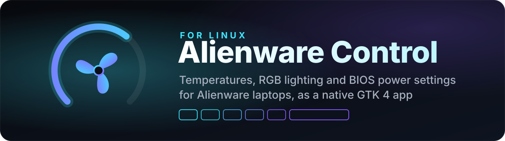
</p>

<p align="center">
  
  
  
  
  <br>
  
  
  
</p>

<p align="center">
  <b>Alienware Control for Linux: a native control panel for Alienware laptops.</b><br>
  Dial gauges for temperatures and fans, per-key RGB lighting with hardware effects,<br>
  BIOS thermal mode, Turbo Boost and battery charging, and a low disk space alert.
</p>

<p align="center">
  <a href="#screenshots">Screenshots</a> ·
  <a href="#features">Features</a> ·
  <a href="#install">Install</a> ·
  <a href="#how-it-works">How it works</a> ·
  <a href="#help-with-other-models">Other models</a>
</p>

<p align="center">
  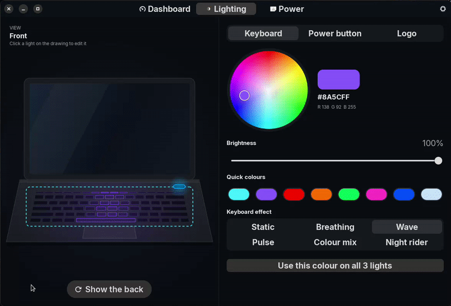
</p>

> [!IMPORTANT]
> ### Tested only on an Alienware m15 R7
> Developed and tested on a single machine: an **Alienware m15 R7** (Intel Core i7-12700H, NVIDIA GeForce RTX 3070 Ti Laptop GPU, per-key RGB keyboard, BIOS 1.41.0) running **Zorin OS 17.3** (Ubuntu 22.04 base), kernel 6.8, GNOME 43, GTK 4.10 and libadwaita 1.3.
> The dashboard works on any Linux computer. Lighting and BIOS settings depend on the exact hardware, so on other models they may work partly, not at all, or behave differently. [Reports are welcome](#help-with-other-models).

> [!CAUTION]
> ### Use at your own risk
> This software talks directly to your laptop's lighting controllers and changes **BIOS settings** (thermal mode, Turbo Boost, battery charging). It is provided **"as is", without warranty of any kind**, express or implied.
> **By installing or using it, you take full responsibility** for any consequences. The author is not liable for any damage to your hardware, loss of data, voided warranty or any other problem resulting from its use.
> It is an unofficial project, not affiliated with, endorsed by or supported by Dell or Alienware. If you are not comfortable with these risks, do not install it.

## Screenshots

### Dashboard
Live dial gauges, disk usage with risk labels and battery health.

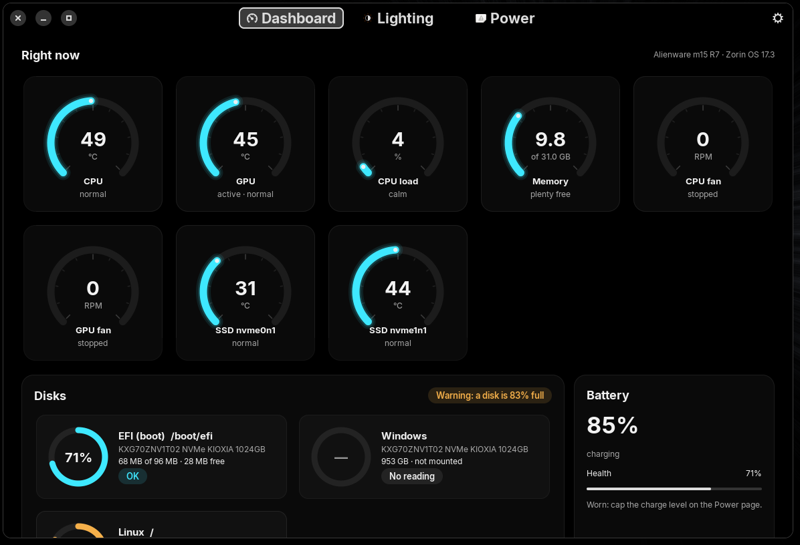

### Lighting
Colour wheel, brightness and six hardware keyboard effects. One click flips the laptop to edit the lid logo.

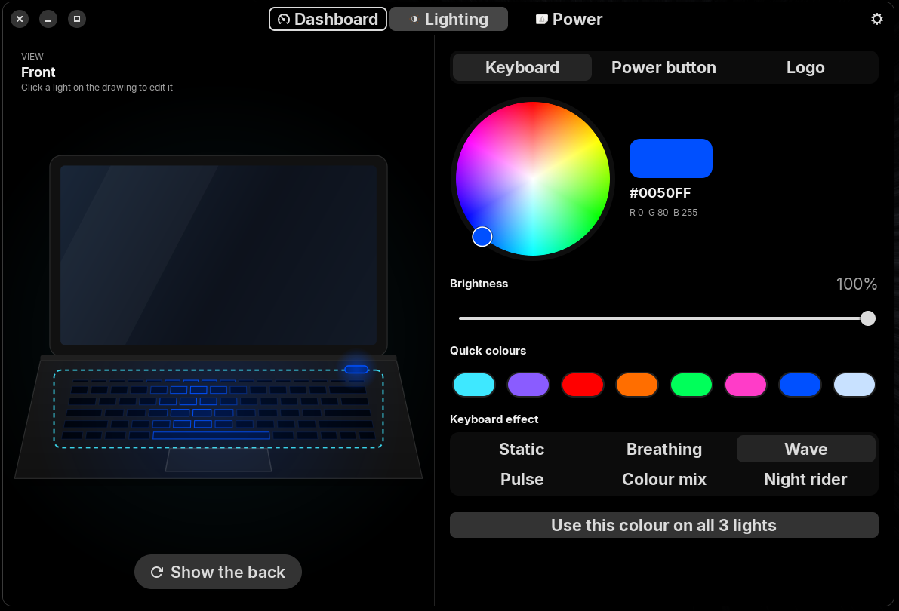

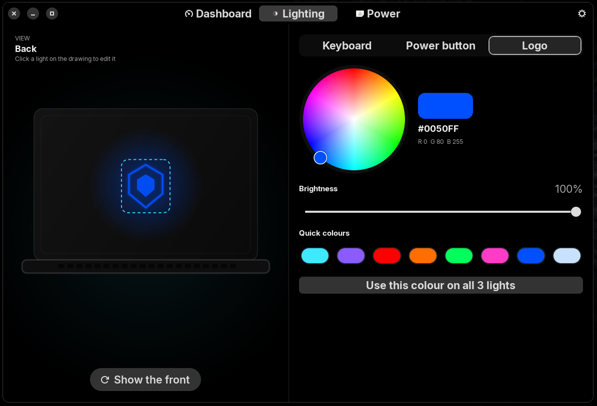

### Power
Power profile, BIOS thermal mode, Turbo Boost and battery charging mode.

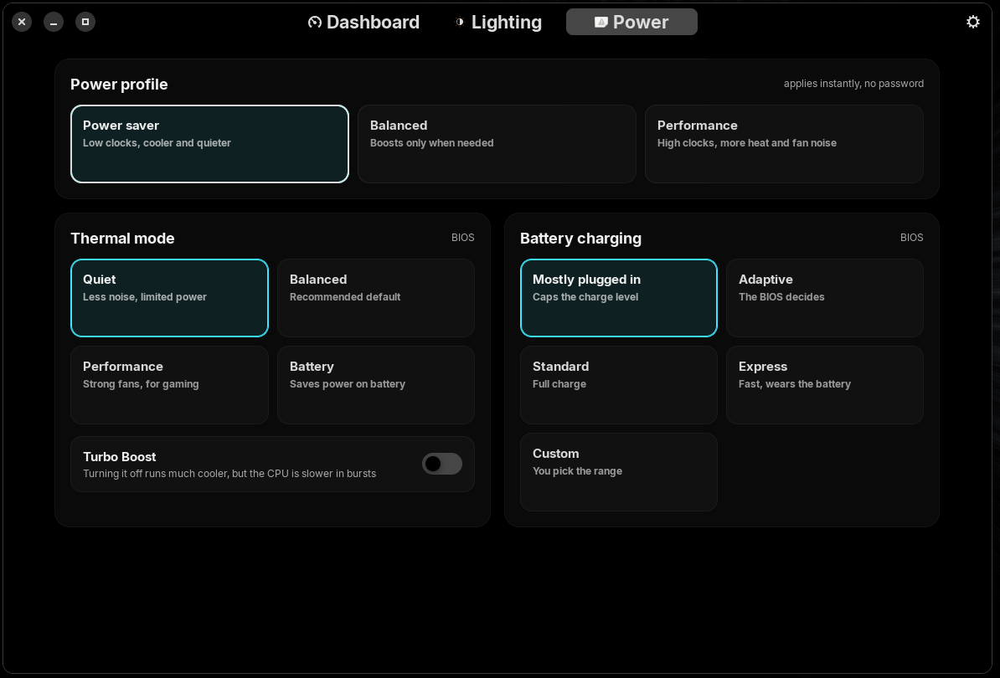

<details>
<summary><b>More screenshots: settings, themes, Portuguese, installer</b></summary>

#### Settings
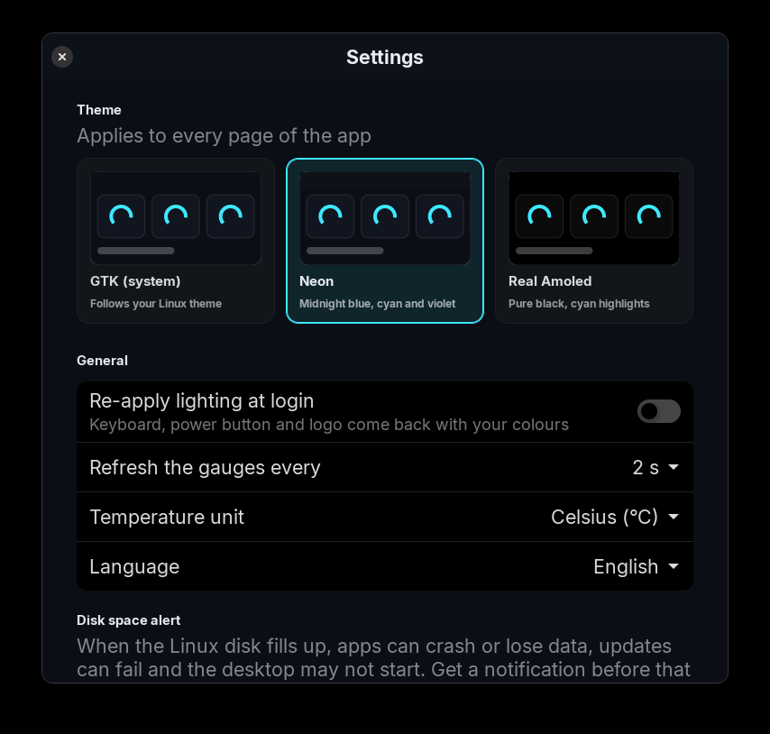

#### GTK (system) theme
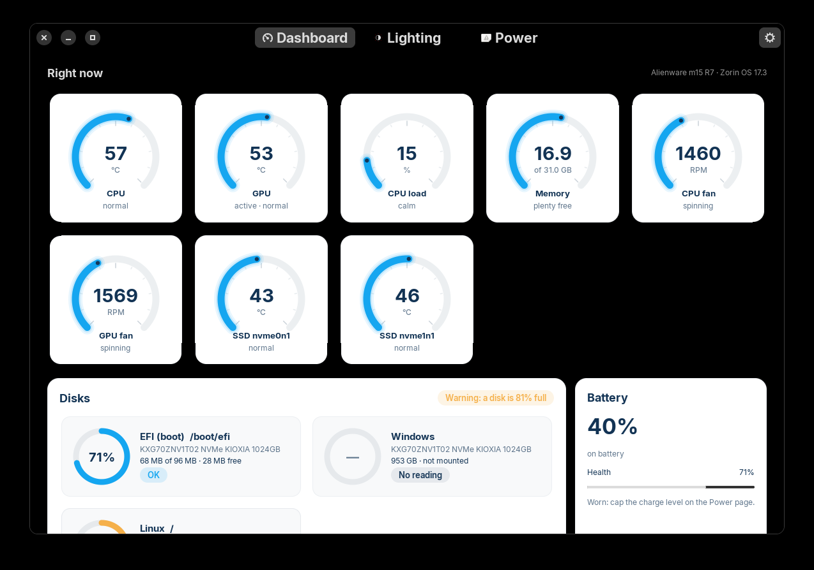

#### Portuguese, Real Amoled theme
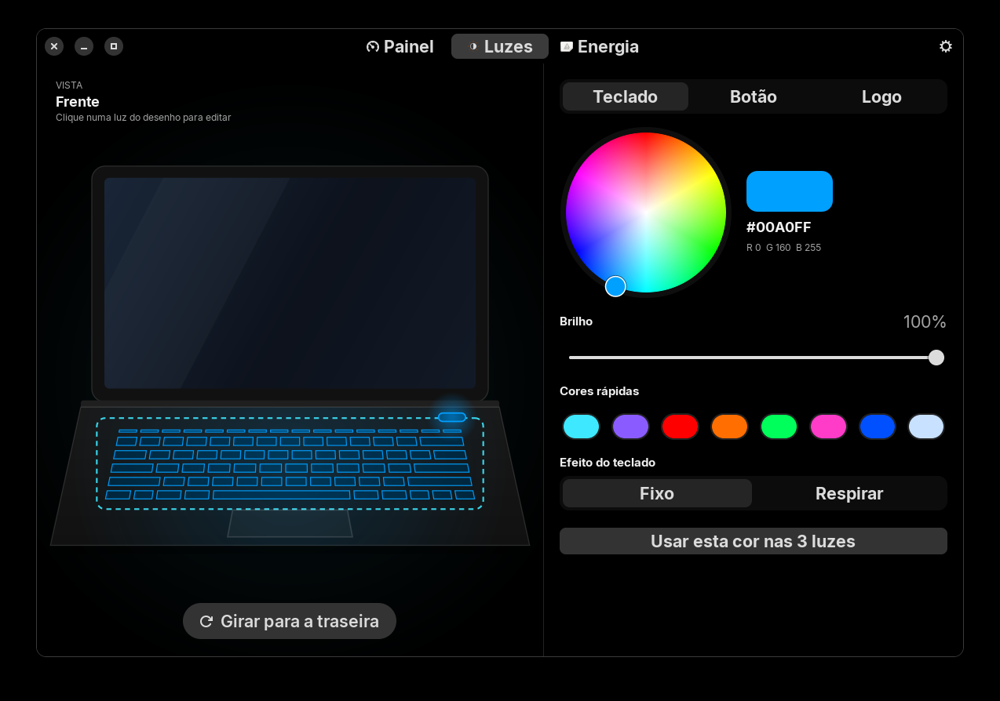

#### Graphical installer
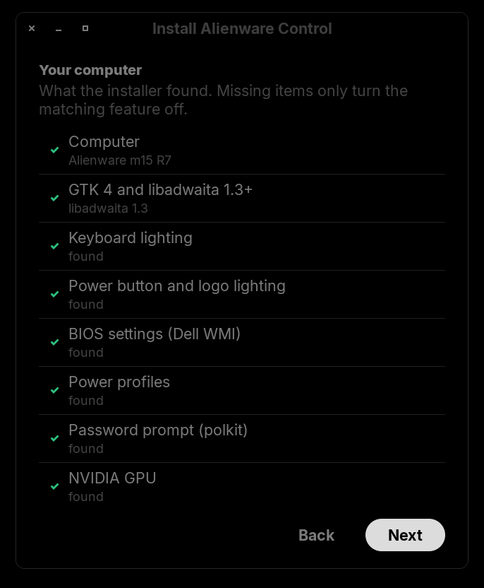
</details>

## Features

### Dashboard
- Dial gauges for CPU and GPU temperature, CPU load, memory, every fan and every NVMe SSD. The arc turns amber when warm and red when hot.
- The GPU gauge never wakes the NVIDIA card just to read it.
- Disk rings for every mounted volume, including LUKS and LVM, labelled OK, Warning (80%) or Risk (90%).
- Battery charge, status and health compared with the design capacity.

### Lighting
- A drawing of the laptop that lights up with your colours, and flips with an animation to show the lid.
- Click the keyboard, power button or logo on the drawing to edit it.
- Colour wheel, brightness, hex and RGB readout, quick colours.
- Six keyboard modes: **static, breathing, wave, pulse, colour mix and night rider**. They run on the keyboard itself, so they keep going with the app closed.
- Colours are re-applied at every login.

### Power
- Power profile (power saver, balanced, performance) through `power-profiles-daemon`, no password.
- BIOS thermal mode: quiet, balanced, performance, battery.
- Turbo Boost on or off.
- Battery charging mode, including a custom start and stop range. "Mostly plugged in" stops a laptop that lives on the charger from sitting at 100%.
- A banner tells you when the BIOS needs a restart.

### Settings
- Three themes: **GTK (system)** follows your desktop theme, **Neon** and **Real Amoled**.
- English or Brazilian Portuguese, or follow the system.
- Gauge refresh rate, °C or °F.
- **Disk space alert:** a desktop notification when a Linux disk passes your threshold. A full Linux disk can crash apps, break updates half-way and stop the desktop from starting. It keeps watching with the app closed, using about 19 MB of RAM.

## Install

> [!TIP]
> On Debian, Ubuntu, Linux Mint, Zorin OS or Pop!_OS, the `.deb` package is the easiest way: double-click it and your software center does the rest.

### Option 1: the .deb package (Debian-based distributions)

Download `alienware-control_<version>_all.deb` from the [Releases](https://github.com/mauriciopazpp/alienware-control-linux/releases) page and double-click it. Remove it the same way, or with `sudo apt remove alienware-control`.

Build it yourself with `installer/build-deb.sh`, which writes it to `dist/`.

### Option 2: the graphical installer (any distribution)

```sh
git clone https://github.com/mauriciopazpp/alienware-control-linux.git
cd alienware-control-linux
/usr/bin/python3 installer/installer.py
```

Or double-click **Install** (`Install.desktop`) in the folder. That works in KDE Dolphin, Nemo, Thunar and Caja. GNOME Files 42 and newer no longer run launchers from regular folders, so on GNOME use the command above.


The installer checks your computer, shows which features will work, asks for your password once and installs everything. Run it again later to update.

<details>
<summary><b>Launcher does not start? (trusting downloaded launchers)</b></summary>
<br>

The first time, your file manager may ask you to trust the launcher:
- **KDE Dolphin:** confirm the "Execute" prompt.
- **Nautilus and others:** right-click **Install**, choose **Allow Launching**. If that option is missing, the files lost their execute permission while unzipping: run `chmod +x Install.desktop Uninstall.desktop`, or `gio set Install.desktop metadata::trusted true`.
</details>

### Option 3: from the terminal

```sh
sudo installer/install.sh              # add --gpu-sleep to let the NVIDIA GPU sleep when idle
```

Afterwards open **Alienware Control** from your app menu, or run `alienware-control`.

### Requirements

| | |
|---|---|
| **Required** | Python 3, GTK 4 (4.6+) and libadwaita (1.3+) with their Python bindings |
| **BIOS settings** | polkit (`pkexec`) |
| **Lighting** | udev with `uaccess` (systemd-logind or elogind) |
| **Optional** | `power-profiles-daemon` for the power profile buttons |

Ubuntu 22.04 itself ships libadwaita 1.1. Ubuntu 23.04+, Fedora 38+, Debian 13 and current Arch and openSUSE are fine.

```sh
# Debian, Ubuntu, Linux Mint, Zorin OS, Pop!_OS
sudo apt install python3-gi python3-gi-cairo gir1.2-gtk-4.0 gir1.2-adw-1
# Fedora
sudo dnf install python3-gobject python3-cairo gtk4 libadwaita
# Arch, Manjaro, EndeavourOS
sudo pacman -S python-gobject python-cairo gtk4 libadwaita
# openSUSE
sudo zypper install python3-gobject python3-gobject-cairo typelib-1_0-Gtk-4_0 typelib-1_0-Adw-1
```

### Uninstall

- **From the .deb:** your software center, or `sudo apt remove alienware-control`.
- **From the installer:** double-click **Uninstall**, run `/usr/bin/python3 installer/installer.py --uninstall`, or `sudo installer/uninstall.sh`.

Your settings stay in `~/.config/alienware-control`.

## How it works

The app runs as your normal user. It needs root for exactly two small helper scripts, and asks polkit for them.

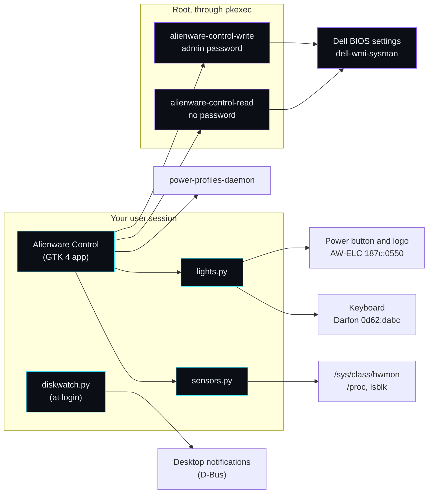

<details>
<summary><b>Sensors</b></summary>
<br>

Everything is read straight from `/sys` and `/proc`, with no extra packages and no root. The app tries the common drivers in turn: Intel `coretemp`, AMD `k10temp`/`zenpower`, Dell `dell_smm` (fans) and `dell_ddv`, `amdgpu`, `nouveau`, `nvme`. Anything missing is simply not shown.

The GPU temperature comes from the Dell `Video` sensor. Calling `nvidia-smi` would reset the GPU's idle timer and keep it awake forever, so the app never does that. The active or sleeping state comes from the PCI runtime power status.

Disks come from `lsblk` and usage from `statvfs`, the same numbers `df` shows. Volumes inside LUKS, LVM or RAID are found too, and older `lsblk` versions (util-linux before 2.37) are supported.
</details>

<details>
<summary><b>Lighting protocols</b></summary>
<br>

The m15 R7 has two separate USB HID lighting controllers, driven through `/dev/hidraw`:

| Light | Controller | Protocol |
|---|---|---|
| Keyboard (every key) | Darfon `0d62:dabc` | 64-byte feature reports, report ID `0xCC` ("API v5" in alienfx-tools) |
| Power button | Alienware AW-ELC `187c:0550`, zone 2 | 33-byte reports |
| Lid logo | Alienware AW-ELC `187c:0550`, zone 3 | 33-byte reports |

The keyboard sequence was found by testing on the real machine. Set the brightness first, because that command resets the controller. Then leave hardware-effect mode (`80 01 FE`). Then paint the keys (`8C 02 00 [id+1 R G B]…`, `8C 13`, `8B 01 FF`). Painting keys while an effect is active blanks the keyboard.

Effects are one hardware command, `80 <type> <tempo> … <RGB1> <RGB2>`, then `8B 01 FF`:

| Type | Effect | On the m15 R7 |
|---|---|---|
| 2 | Breathing | works |
| 3 | Wave | works |
| 4 | Dual-colour wave | no reaction |
| 8 | Pulse | works |
| 9 | Colour mix (pulse between two colours) | works |
| 10 | Night rider | works |
| 11 | Laser | no reaction |

Safety rules in the code (they guard against bugs in this app, see [Security](#security)):
- Each controller module only sends commands from a short allow-list and raises an error for anything else. Effects are limited to the five confirmed on hardware.
- Nothing is saved to the controllers. The AW-ELC save, set-default, set-startup and flash-erase commands are blocked, so restarting always brings back the factory lighting.
- Writes run in a background thread, one at a time, with pauses between packets, because bursts can hang these controllers.
</details>

<details>
<summary><b>BIOS settings</b></summary>
<br>

Dell exposes BIOS settings through the kernel's `dell-wmi-sysman` driver as files under `/sys/class/firmware-attributes`. Two helpers run through `pkexec`:

- `alienware-control-read` prints the supported settings as JSON. The polkit policy allows it without a password for the active local user.
- `alienware-control-write bios <Setting> <Value>` changes one setting and asks for the admin password, remembered for a few minutes. It accepts five known settings (`AWThermalManagement`, `TurboMode`, `PrimaryBattChargeCfg`, `CustomChargeStart`, `CustomChargeStop`) and only values the BIOS itself reports, or inside its numeric range.

Some changes only apply after a restart. The app reads the BIOS's `pending_reboot` flag and shows a banner.
</details>

<details>
<summary><b>Disk space alert, themes and translations</b></summary>
<br>

**Disk space alert.** `diskwatch.py run` starts at login while the alert is on. Every 10 minutes it checks the mounted Linux filesystems (ext4, btrfs, xfs, f2fs and others) and sends a standard `org.freedesktop.Notifications` message, so it works on GNOME, KDE, XFCE, Cinnamon and others. It repeats a warning at most once a day, and right away at 98%. A lock file keeps it to one copy. Try it with `python3 alienware_control/diskwatch.py check` or the Test button in Settings.

**Themes.** GTK (system) looks up your GTK theme in `~/.themes`, `~/.local/share/themes` and the system folders. It loads the theme's `libadwaita.css` if there is one, otherwise only the `@define-color` lines of its GTK 4 CSS. With neither, plain libadwaita follows the system light or dark setting. Neon and Real Amoled are built in.

**Translations.** Strings are written in English and go through `_()` in `alienware_control/i18n.py`. To add a language, add its code to `LANGUAGES` and a dictionary to `CATALOGS`. Missing strings fall back to English.
</details>

<details>
<summary><b>Optional: let the NVIDIA GPU sleep</b></summary>
<br>

On some hybrid-graphics laptops the NVIDIA GPU never sleeps because its HDMI audio function stays powered, which wastes 10 to 15 W and keeps the GPU fan spinning. `sudo installer/install.sh --gpu-sleep` (a switch in the graphical installer) adds a udev rule that lets it suspend when nothing uses it.
</details>

<details>
<summary><b>Files the app writes</b></summary>
<br>

| Path | What |
|---|---|
| `~/.config/alienware-control/config.json` | Settings |
| `~/.config/alienware-control/lights.json` | Saved colours |
| `~/.config/autostart/alienware-control-lights.desktop` | Re-applies lighting at login (only after you save colours) |
| `~/.config/autostart/alienware-control-diskwatch.desktop` | Disk space alert at login (while enabled) |
| `~/.local/state/alienware-control/` | Disk alert state and lock file |
</details>

## Security

- **Root access** is limited to the two helper scripts. They take fixed setting names, check every value against what the BIOS reports, and are the only commands the polkit policy allows. Reading is passwordless only for the active local session; every change asks for the admin password.
- **Lighting access:** the udev rule gives the user at the computer (the active seat) access to the two lighting devices, USB interface 0 only. Any program running as that user can talk to them, not only this app. The keyboard device also carries keystrokes, which is no new exposure on X11, where any app can already read the keyboard. The allow-lists in `awkbd.py` and `awelc.py` protect against bugs in this app, not against other malicious software running as you. Skip the udev rule if that matters to you: lighting stops working and everything else keeps working.
- **Without systemd-logind or elogind** (seatd-only setups), `uaccess` does nothing. Replace `TAG+="uaccess"` with `GROUP="input", MODE="0660"` in `/etc/udev/rules.d/70-alienware-control.rules` and add yourself to that group.

## Help with other models

Tried it on a different Alienware or Dell G-series laptop? Please [open an issue](https://github.com/mauriciopazpp/alienware-control-linux/issues) with the output of:

```sh
cat /sys/class/dmi/id/product_name
lsusb | grep -iE '187c|0d62'
ls /sys/class/firmware-attributes/*/attributes 2>/dev/null | head -50
sensors
```

Also say which lights changed and which zone lit what. Zone numbers and key IDs can differ between models.

## Project layout

```
alienware_control/   the app (Python, GTK 4 + libadwaita)
helpers/             the two root helpers for BIOS settings
data/                icon, menu entry, polkit policy, udev rules
installer/           graphical installer, install/uninstall scripts, .deb builder, release script
screenshots/         images used in this README
```

## Credits

The lighting protocols were worked out with help from [alienfx-tools](https://github.com/T-Troll/alienfx-tools) by T-Troll (MIT), [alien-lights](https://github.com/JakeLaney/alien-lights) and [alienrgb](https://docs.rs/crate/alienrgb).

Not affiliated with, endorsed by or supported by Dell or Alienware. "Alienware" is a trademark of Dell Inc. The lid emblem in the app is a generic drawing, not the Alienware logo.

## Disclaimer

This project is provided "as is", without warranty of any kind. You use it entirely at your own risk and are solely responsible for any damage to your computer, its battery, its firmware settings or your data, and for any effect on your manufacturer warranty. Always make sure you know how to reset your BIOS settings (F2 at boot, then "Restore Settings") before changing them from any tool.

## License

[MIT](LICENSE) © 2026 Mauricio Paz. See the license for the full warranty disclaimer.
